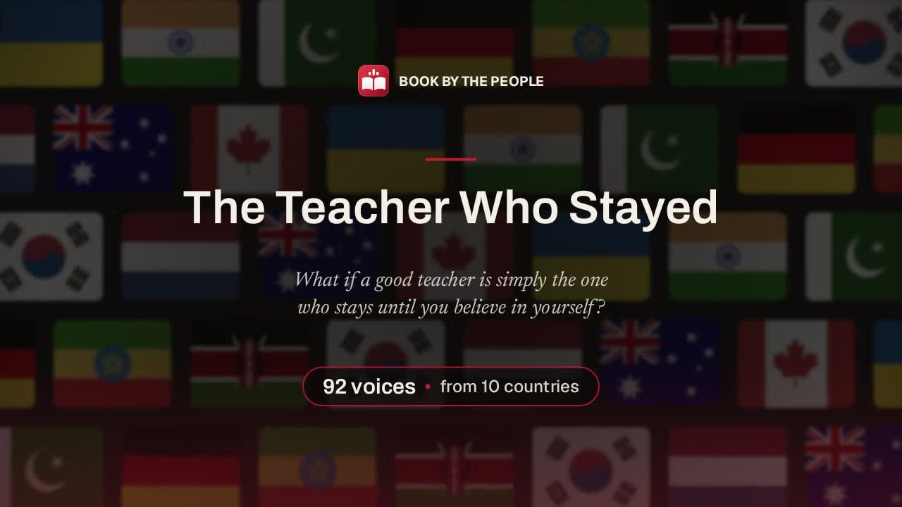
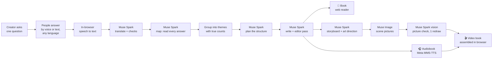
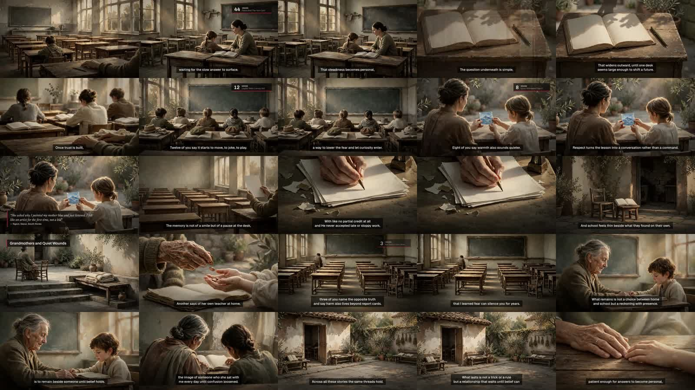
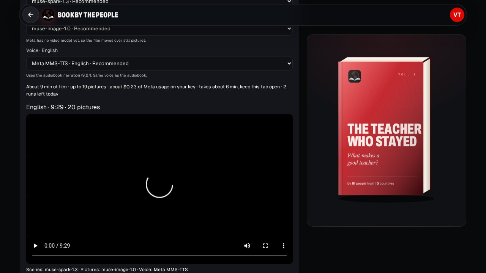

<div align="center">

# 📖 Book by the People

**Thousands of real voices, one beautiful book. Plus an audiobook and a video book, all made with Meta's models.**

[](https://book-by-the-people.vercel.app)




**[Try it live](https://book-by-the-people.vercel.app)** · **[Watch the demo video](https://youtu.be/0tCJ3Fv0c2Q)** · [How it works](#how-it-works) · [Meta models](#where-each-meta-model-is-used) · [Run it locally](#run-it-locally)

</div>

---

## The problem

When millions of people share opinions online, their voices get lost in endless comments and feeds. Nobody reads them all, and nothing lasting is made from them. Communities, creators, teachers and organisations have no simple way to collect what many people really think and turn it into something people want to read.

**Book by the People** turns a crowd of answers into a real book, written in one calm narrator voice, with true counts ("nearly fifty of you said…") and people's exact words. Then it reads the book aloud and turns it into a film.

## How it works

1. **Create.** A creator asks one question, for example *"What makes a good teacher?"* The book can be solo, invite-only, open to anyone, or built from sourced public quotes.
2. **Contribute.** Anyone answers by speaking or typing, in their own language. Speech is turned into text privately in the browser. Muse Spark translates each answer into the book's language. A live 3D globe shows every voice as it arrives.
3. **The AI writes the book.** When voices close, Muse Spark reads every answer, groups similar opinions with real counts, decides the shape of the book (chapters, or one flowing piece when most people agree), and writes it. A final editor pass smooths the flow without changing any number or quote.
4. **Audiobook.** The book is narrated by Meta's open MMS-TTS voice in up to 11 languages, with natural pauses, light EQ and compression, and even loudness.
5. **Video book.** Muse Spark plans the scenes and one shared art style, Muse Image draws them, and Muse Spark checks every picture and redraws weak ones once. The film opens on a wall of every participating country's flag, with captions, quotes and slow pan-and-zoom. It is put together in the creator's browser.



## Where each Meta model is used

In hackathon mode (`HACKATHON_META_ONLY`, on by default) every AI picker shows only Meta models.

| Step | Meta model | Where it runs |
|---|---|---|
| Translate answers into the book's language | **Muse Spark** `muse-spark-1.3` | Meta Model API |
| On-topic, duplicate and impersonation checks | **Muse Spark** | Meta Model API |
| Read all answers in batches, pull out opinions and exact phrases | **Muse Spark** | Meta Model API |
| Merge themes across batches, pick structure and story arc | **Muse Spark** | Meta Model API |
| Write every section in one narrator voice, then edit | **Muse Spark** | Meta Model API |
| Narration polish (short spoken sentences, numbers as words) | **Muse Spark** | Meta Model API |
| Storyboard and one shared art direction for the film | **Muse Spark** | Meta Model API |
| Draw each scene of the video book | **Muse Image** `muse-image-1.0` | Meta Model API |
| Check each picture (text, bad hands or faces) and ask for a redraw | **Muse Spark** (vision) | Meta Model API |
| Narrate the audiobook and the video book | **Meta MMS-TTS** (open weights, ONNX) | Our own server, free |

Optional: server speech-to-text with Muse Voice Transcribe, and a fallback writer pointed at self-hosted Muse Spark Open on any OpenAI-compatible host.

## See it



*Frames from a finished video book. Every picture is by Muse Image in one shared style, with captions and count chips.*



*The Studio Release tab. Each step has its own Meta model picker, a cost estimate, and resume if the tab closes.*

## Features

- **Four kinds of book:** solo, invite-only (private link), open (public page with live globe), and famous voices (only quotes the creator pastes with a source link; the app never invents quotes or copies anyone's voice).
- **Any language in, any language out.** Answers are translated with Muse Spark; release languages each get their own narration where a Meta voice exists.
- **Honest numbers.** Counts come from real grouped answers, never from the model's guess.
- **Exact quotes only.** Any quoted phrase must appear word for word in a real answer, or its quote marks are removed.
- **Well-known mark.** A famous name is shown only when verified by the creator; a voice that only *claims* a famous name is never named.
- **Big books.** Writing saves a checkpoint after every step and continues across requests, so large books finish inside serverless time limits.
- **Re-run only what changed.** Scripts, voice parts and pictures are cached by hash. Change the voice and only the voice is redone.
- **Copy the whole book** as plain text, or upload your own audio or video made with another tool.
- **Usage limits per book** (no limit, dollars or tokens), with every AI call logged in Studio.
- **Daily limits** for fairness: 3 voices per person per book per day, and 3 media runs per book per day.

## Tech stack

| Layer | What we use |
|---|---|
| App | Next.js 16 (App Router), React 19, TypeScript, Tailwind CSS |
| Data | Prisma, SQLite locally, Neon Postgres in production |
| Files | Vercel Blob in production, local disk or any S3 store elsewhere |
| AI | Meta Model API (Muse Spark, Muse Image), OpenAI-compatible client |
| Voice | Meta MMS-TTS through `onnxruntime-node`, MP3 encoding with lamejs |
| Speech to text | Whisper Base running in the browser (no audio leaves the device for typing) |
| Film | Browser rendering with WebCodecs and mediabunny (H.264, 1280×720) |
| Flags | flag-icons SVGs (MIT), 257 flags bundled in `public/flags` |
| Hosting | Vercel Hobby (free) |
| Tests | Vitest (unit), Playwright (end to end) |

## Architecture

- **Short, resumable steps.** Vercel Hobby allows 300 seconds per function. The Studio page drives the work one step at a time (`POST /api/books/<id>/media/meta/step`). Each step takes a lease, does under about 200 seconds of work and saves it. If the tab closes, the next visit resumes. Each unit retries up to 3 times.
- **Writer pipeline:** map (batches of about 60 answers, 6 at a time) → reduce (merge themes, true counts) → plan (form, arc of up to 8 sections, standout quotes) → write (sections in parallel) → edit (refused if it changes any number or shrinks a paragraph too much). The saved outline is the "producer notes" that the audiobook and film both follow.
- **Audio:** each sentence is read phrase by phrase, trimmed, levelled, given light EQ and compression, joined with short crossfades and encoded once to MP3 (64 kbps). Chapter marks and per-sentence timings are saved, so captions stay in sync.
- **Film:** scene times come from the sentence timings. The browser draws the film on a canvas and uploads it in 3 MB parts; the server joins and checks the MP4.
- **No schema change for media.** Media state lives in a JSON file per book in storage.

More detail: [docs/book-v2.md](docs/book-v2.md) (writer, audiobook, video book) and [docs/meta-media-pipeline.md](docs/meta-media-pipeline.md) (Meta media pipeline).

## Security and privacy

- **Bring your own key.** Each creator saves their own Meta API key. The app is free to use.
- **Encrypted at rest** with AES-256-GCM (`AI_KEY_SECRET`). Keys are never sent back to the browser; only the last 4 characters are shown.
- Keys are opened only inside the server step, used in the request header, and dropped. Errors are scrubbed of secrets. Prompts carry only book text, never keys or emails.
- Owner-only and same-origin checks on every Studio and media route. An end-to-end test (`e2e/key-privacy.spec.ts`) checks the key never appears in any response.
- Speech for typing is turned into text in the browser.

## Cost and scale

- A full 92-voice run (book, audiobook and video book) cost about **$0.40** in Meta credits in our test.
- Pictures cost about $0.01 each. The writer used about 44k tokens for a 92-voice book.
- Narration is free: MMS-TTS runs on our own server, faster than real time on one CPU.
- Writing was load-tested with **1,500 voices from 45 countries** (against a fake Meta server): it finished in two requests with no step repeated.

## Honest limits

- **Meta has no hosted text-to-speech or video API yet.** We self-host MMS-TTS for the voice and build the film from Muse Image stills in the browser.
- **MMS-TTS is licensed CC-BY-NC 4.0** (non-commercial). Fine for this free project and the hackathon; it must be replaced or licensed before any commercial use.
- MMS-TTS has one plain voice per language. Japanese, Italian and Chinese have no MMS voice, so those languages get no audiobook (the app says so instead of switching voices quietly).
- Vercel has no ffmpeg, so the film is rendered in the creator's browser (Chromium works best).

## Run it locally

Needs Node.js 20+.

```bash
git clone https://github.com/uzerkayat2004-gif/book-by-the-people.git
cd book-by-the-people
cp .env.example .env      # works with no keys: AI_MODE=mock
npm install
npm run setup             # prisma db push + seed demo books (wipes the local database)
npm run dev               # http://localhost:43123
```

- With no key the app runs in **mock mode**, so you can click through the whole flow for free.
- To use Meta models, sign in, open **Book settings → AI model**, and add your Meta API key. (Or set `AI_MODE=live` and `META_API_KEY` in `.env` for server-wide use.)
- In development the sign-in magic link is shown on screen. Use `localhost`, not `127.0.0.1`, so the cookie matches.

### Tests

```bash
npm test           # Vitest unit tests (27 files, 213 tests)
npm run test:e2e   # Playwright end-to-end tests (needs the dev server on :43123)
npm run lint       # ESLint
```

The Meta audiobook and video tests can run against a fake Meta server (`e2e/fixtures/fake-meta.mjs`). See [docs/meta-media-pipeline.md](docs/meta-media-pipeline.md).

### Deploy

Free setup with no card and no domain: **Vercel Hobby** for the app, **Neon Postgres** and **Vercel Blob** added from inside Vercel. `npm run build` writes the Postgres Prisma schema automatically. Full steps in [DEPLOY.md](DEPLOY.md). All settings are listed in [.env.example](.env.example) and the [developer guide](docs/developer-guide.md).

## Project layout

| Path | What is there |
|---|---|
| `src/app` | Pages and API routes (book page, speak, reader, Studio, media steps) |
| `src/lib/ai` | Meta Model API client, writer pipeline, key handling |
| `src/lib/book` | Book logic: grouping, structure, quote checks, plain text |
| `src/lib/media/meta` | Audiobook (MMS-TTS, sound), storyboard, pictures, film plan, browser film |
| `src/components` | Reader, Studio, globe, voice recorder |
| `prisma` | Database schema and demo seed |
| `e2e` | Playwright tests and the fake Meta server |
| `docs` | Pipeline write-ups and the developer guide |

## Meta Global AI Developer Hackathon

Built for the **Meta Global AI Developer Hackathon** (2026).

- **Track:** Indie Developer
- **Problem statement:** Build for your world
- **Meta tooling:** Muse Spark 1.3, Muse Image 1.0, Muse Spark vision, Meta MMS-TTS
- **Live app:** https://book-by-the-people.vercel.app
- **Demo video:** [youtu.be/0tCJ3Fv0c2Q](https://youtu.be/0tCJ3Fv0c2Q)

## License

[MIT](LICENSE) © Uzair Kayat. Bundled flag icons are from [flag-icons](https://github.com/lipis/flag-icons) (MIT). The Meta MMS-TTS voice weights are not part of this repo; they are downloaded at run time and are licensed CC-BY-NC 4.0 by Meta.

---

<div align="center">

Built by **Uzair Kayat** · made by the people, for the people.

</div>
